# Harry Potter Chamber of Secrets for Mac

*Harry Potter and the Chamber of Secrets* (Eurocom / Electronic Arts, 2002), the original Xbox version, running natively on Apple
Silicon Macs.

## What it is

The game's own program, translated from the Xbox's x86 code into C and compiled for your Mac. It is not an emulator: there is no
virtual Xbox, the game runs as a normal Mac app, with the disc's own levels, voices, music, cutscenes and movies. On top of that it
has the things that make it play well on a Mac: up to 4x the Xbox's resolution, anti-aliasing, sharper textures at an angle,
bloom, a settings menu over the game, and a few tweaks: skip the logo movies, and skip cutscenes.

Almost everything here is other people's work, and this is their port as much as ours:

- [xboxrecomp](https://github.com/sp00nznet/xboxrecomp) by **sp00nz** translates Xbox games to C and stands in for the Xbox's
  hardware and system.
- [nfsu2-sw](https://github.com/antoxa2584x/nfsu2-sw) by **antoxa2584x** and [nfsu2-ios](https://github.com/myUdav4iik/nfsu2-ios)
  by **myUdav4iik** built the engine around it, with an Apple host and a Metal renderer, for *NFS Underground 2*;
  [NFSU2Deadware](https://github.com/LeoDeadware/NFSU2Deadware) by **LeoDeadware** made that engine a Mac game. This port runs
  on the same engine, by way of the [NFS Underground 2 port](https://github.com/sanyokkua/nfsu2-xbox-port) and the
  [Sorcerer's Stone port](https://github.com/sanyokkua/hp1-xbox-port). The two Harry Potter games are by different studios and
  have different engines; only the Xbox platform stack is shared.
- [HP-COS-Xbox-Recomp](https://github.com/MiddleDucky/HP-COS-Xbox-Recomp) by **MiddleDucky** recompiled this very game for
  Windows first and wrote down what it needs: where its functions hide, how its controller and movies work, a race in its file
  cache. This port follows its findings and, for the logo skip, its code. [HP2-Recompiled](https://github.com/Barthes-Recompiled/HP2-Recompiled)
  by **Barthes-Recompiled** (a fork of it) gave the idea of the cutscene fast-forward, and
  [HP-PS-Xbox-Recomp](https://github.com/MiddleDucky/HP-PS-Xbox-Recomp) the direct design of the controller.

This project puts them together without changing the game's look (no HD texture packs), adds the settings menu, the tweaks and
the installer, and keeps the same style as the other ports in this series ([Sorcerer's Stone](https://github.com/sanyokkua/hp1-xbox-port),
[NFS Underground 2](https://github.com/sanyokkua/nfsu2-xbox-port), [NFS Underground](https://github.com/sanyokkua/nfsu-xbox-port),
[NFS Hot Pursuit 2](https://github.com/sanyokkua/nfs-hp2-ps2-port)).

**Status:** version 0.1.2. Played from the logos and the intro movie through New Game, the Burrow, Knockturn Alley and
Borgin & Burkes, Diagon Alley (Flourish & Blotts, the Leaky Cauldron, the Magical Menagerie), the Whomping Willow and the
arrival at Hogwarts into the first school day, at 60 fps at 3x on an M1 Pro, with sound. Saving and loading work.

- It is an experiment, worked on when time allows; it is **not actively supported**.
- The rest of the school year has not been played on the Mac yet. If something breaks, the log (Settings > Advanced > Logs)
  says where; please attach it to an issue.
- **4:3 only** (no widescreen).
- Apple Silicon and **macOS 15 or newer** only, and only the **Xbox USA disc** (the PAL edition is not supported).

How it was made, step by step: [docs/PORTING.md](docs/PORTING.md). Changes per version: [CHANGELOG.md](CHANGELOG.md).

## Install and play

You need an **Apple Silicon Mac with macOS 15 or newer** and your own disc image (ISO) of the **USA Xbox release** of
*Harry Potter and the Chamber of Secrets*. Nothing of the game is included: the installer builds it on your Mac from your disc.

1. Download `Harry-Potter-Chamber-of-Secrets-<version>.dmg` from [Releases](https://github.com/sanyokkua/hpcos-xbox-port/releases) (or build it with `tools/make_dmg.sh`, see below), open it and drag
   **Harry Potter Chamber of Secrets Installer** to Applications.
2. **Open it.** The installer isn't notarized by Apple, so the first time macOS refuses. Close that message (don't move it to the
   Trash), go to **System Settings > Privacy & Security**, scroll to the message about it, click **Open Anyway** and confirm.
3. **Apple's Command Line Tools.** The game is compiled with them. If they aren't installed, macOS offers to install them: click
   Install, and the installer goes on by itself when they are there.
4. **Choose your disc image.** The installer copies the game's files (about 2.5 GB) into
   `~/Library/Application Support/Harry Potter Chamber of Secrets`, checks that it is the USA disc, translates the game's program
   to C and compiles it. On an M1 Pro that took 1 min 27 s, once. A window shows how far it is.
5. **Harry Potter Chamber of Secrets** is put in Applications (in `~/Applications` when Applications isn't writable) and opens.
   Play it from there. You can delete the disc image and the installer afterwards; opening the installer again offers Play or
   Rebuild.

### Controls

**A controller** works as on the Xbox: anything macOS knows (Xbox, PlayStation, MFi), with rumble. Connect it before or while
the game runs. The sticks have a small dead zone, so a pad that rests a little off centre doesn't move Harry or the camera.

**The keyboard** drives the game when no controller is connected (Settings > Input can make it always or never):

| Key | Xbox controller | In the game |
|---|---|---|
| Arrows | D-pad and left stick | menus, walking |
| A / D | left stick left / right | walking |
| W / S | right / left trigger | |
| Enter | A and Start | select, "press Start", pause |
| Esc, Backspace | B | back |
| Space / Left Shift | X / Y | |
| Q / E | White / Black | |
| Tab / P | Back / Start | pause |
| I J K L | right stick | the camera |

The keys can't be changed yet. The controller's buttons are the game's own Xbox layout. A modern pad's bumpers stand in for the
original controller's White and Black buttons: **LB is White, RB is Black** (as in xemu), the triggers are the triggers and the stick
clicks are L3 / R3. A press shorter than one of the game's frames is still seen once.

### The settings menu

| | Controller | Keyboard and mouse |
|---|---|---|
| Open and close | **Back + Start** together | **F1** (on a MacBook **fn+F1**, unless the F-keys are set as standard keys) or **Cmd+,** |
| Choose a setting | D-pad or left stick up/down | arrows up/down, or the mouse |
| Change it | D-pad or left stick left/right, **A** | arrows left/right, Enter, or click the arrows |
| Change page | **LB / RB** | Q / E, Tab |
| Close | **B** | Esc |

While the menu is open the game gets no input. Under the list, the chosen setting says what it does, **where** you will see it
and, after a change, whether it was applied at once or needs a restart. At the bottom: **Reset page**, **Close** and **Quit Game**.

| Page | Setting | Choices | Applies |
|---|---|---|---|
| Display | Display | Window, Full Screen (default) | at once (F11 also switches it, for this run) |
| | Resolution Scale | 1x (640 x 480), 1.5x, 2x, 3x (default), 4x | at once |
| | Picture | Fit (4:3, bars at the sides, default), Fill (stretched over the window) | after a restart |
| | Frame Rate | Original (the game's own pace, default), 60 fps | after a restart |
| Graphics | Anti-Aliasing | On (FXAA, default), Off | at once |
| | Anisotropic Filtering | Off-16x (16x default) | at once |
| | Effects | Bloom (default), Bloom + Ambient Occlusion, Off | at once |
| | Gamma | Original (default), Modern (brighter), Warm | at once |
| Audio | Master Volume | 0-100% (100% default) | at once |
| Input | Vibration | Off, 10-100% (100% default) | at once |
| | Keyboard as Controller | Without a controller (default), Always, Off | after a restart |
| Tweaks | Skip Logo Movies | Off (default), On: no Warner Bros. and EA logos at the start | at the next start |
| | Skip Cutscenes | On (default), Off: press **Start** or **Back** in a cutscene and it runs to its end in a few seconds (about 30x; the picture updates 4 times a second, so a frame counter shows 4, and the sound is muted). Nothing is cut from the story, so whatever the cutscene sets up is set up. A cutscene in two parts goes on into the second | at once |
| Advanced | Performance Overlay | frames per second and the slowest frame, top left | at once (also **Cmd+Option+F**) |
| | Logs | opens the logs folder in Finder | |

The game's own sliders for music, speech and effects are in its **Options**.

### Saving and quitting

The game saves the way it always did: walk up to a **SAVE GAME** scroll and press A. It saves to the slot picked at New Game,
and **Continue** on the title loads it. To quit, use **Quit Game** in the settings menu (it asks first), **Cmd+Q**, or close the
window. Progress since your last save in the game is lost, as when an Xbox is switched off.

### Your files

Everything is in `~/Library/Application Support/Harry Potter Chamber of Secrets/`:

| Folder | What |
|---|---|
| `game/` | the disc's files, and the game's saves |
| `player/` | `settings.ini` (the settings menu) |
| `saves/`, `cache/` | the runtime's |
| `logs/` | `hpcos.log` (the last five runs) and `install.log` |
| `build/` | the translated game and its compiled objects (made by the installer) |

To remove the game, delete **Harry Potter Chamber of Secrets** from Applications and this folder.

## Screenshots

| | |
|---|---|
| 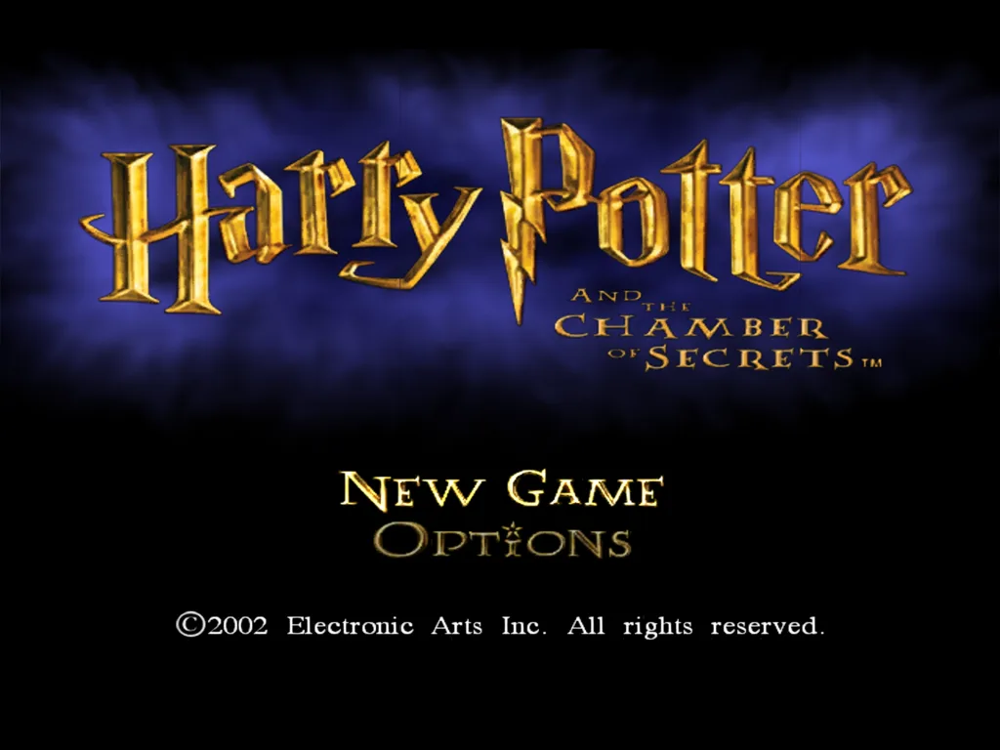 | 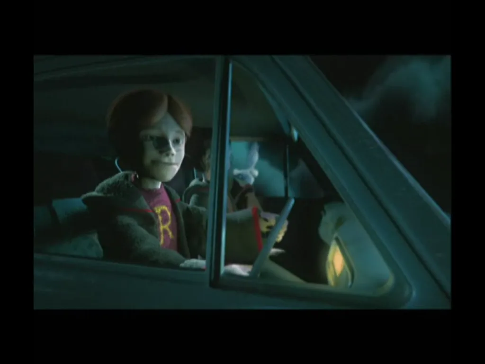 |
| The main menu | The intro movie |
| 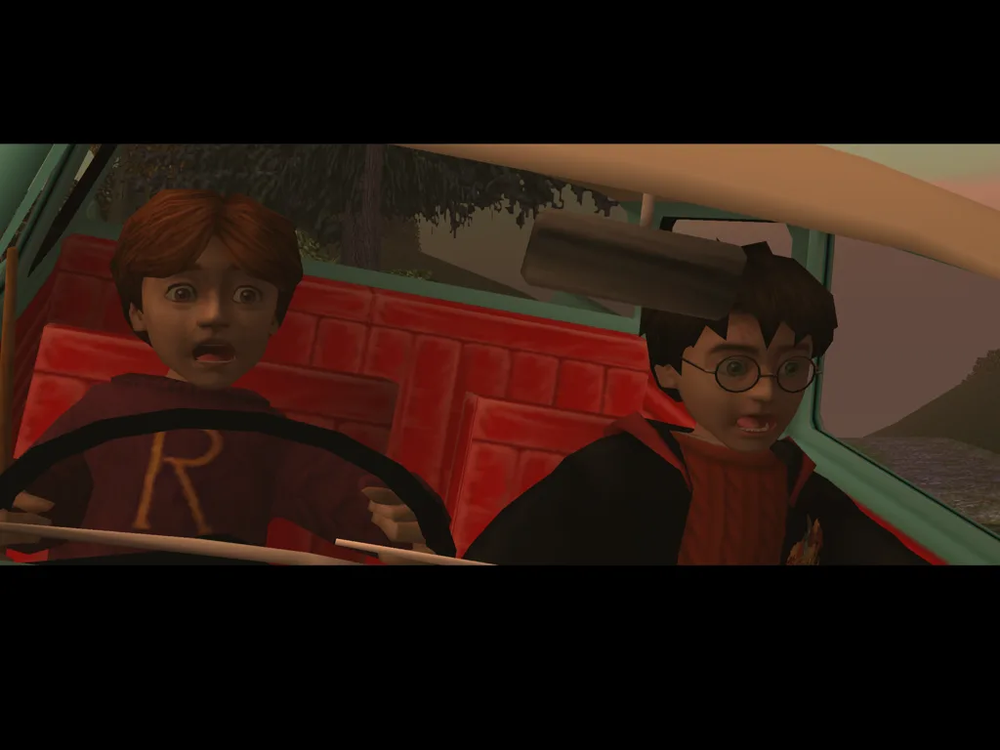 | 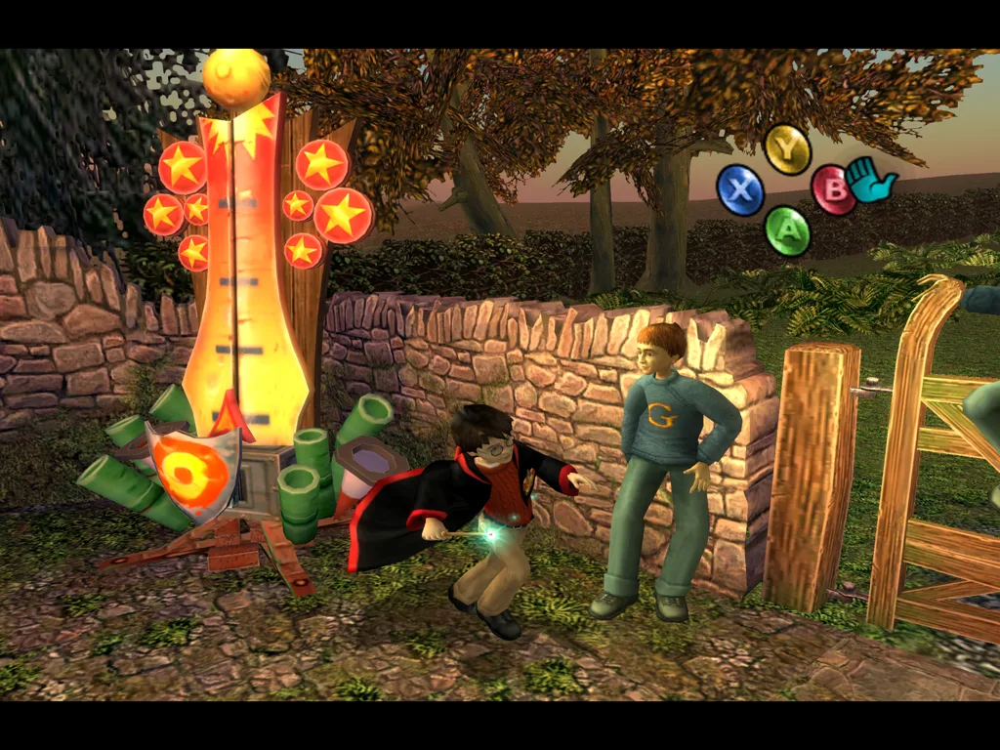 |
| The Burrow cutscene: Ron and Harry in the flying car | Free play at the Burrow |
| 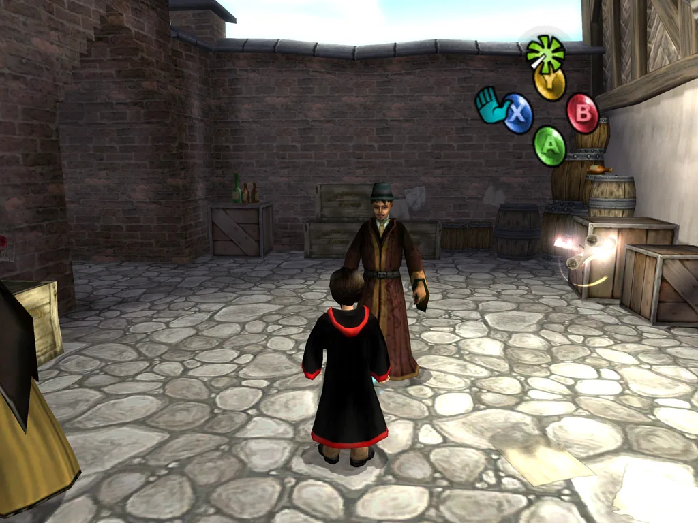 | 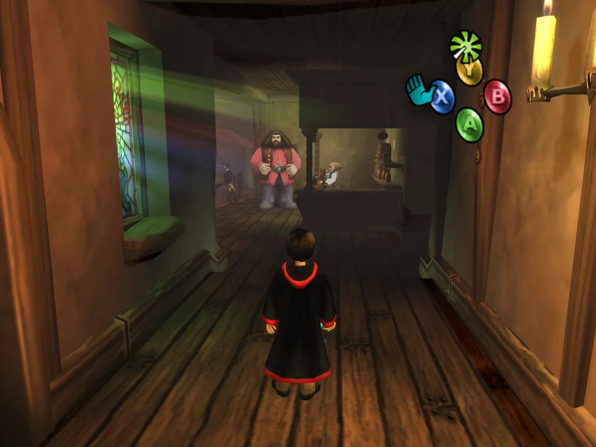 |
| Diagon Alley | The Leaky Cauldron, with Hagrid at the bar |
| 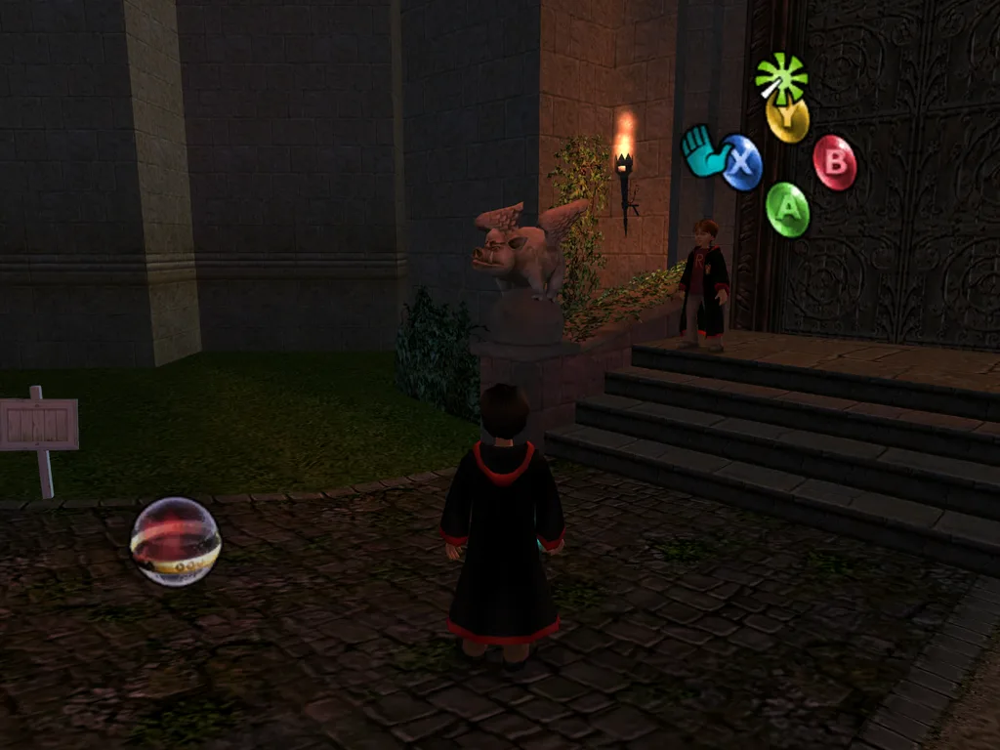 | 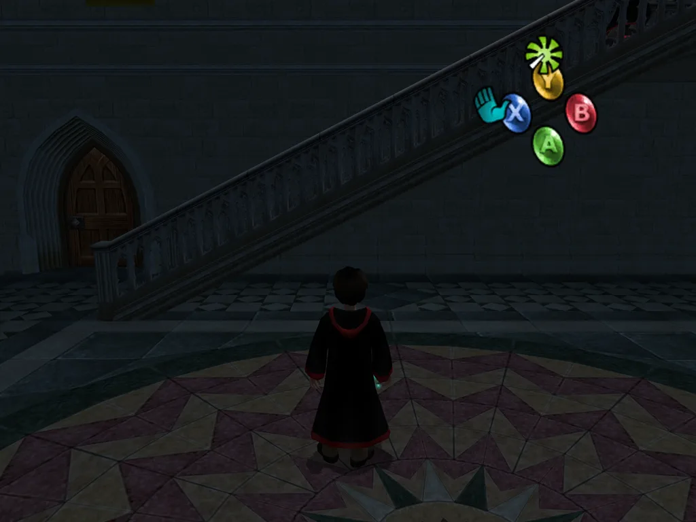 |
| Hogwarts at night, Ron at the door | The Grand Staircase |
| 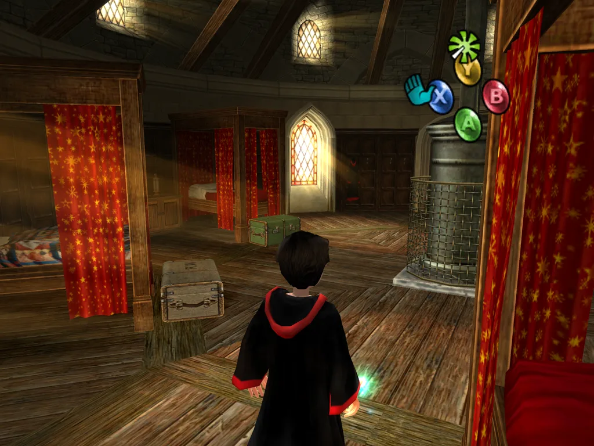 | 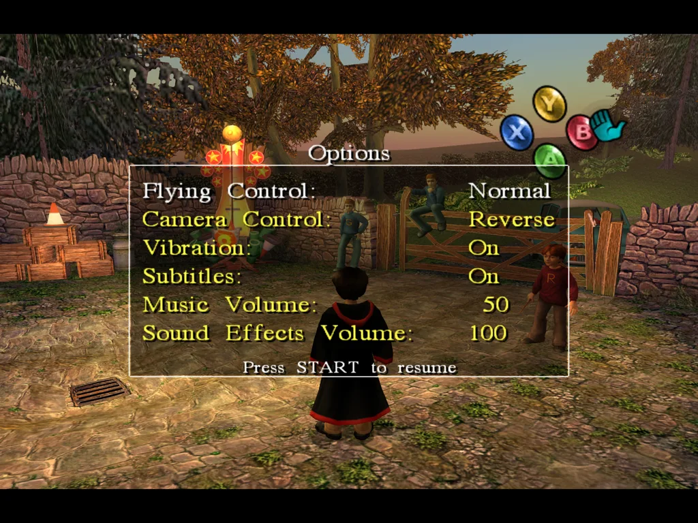 |
| The Gryffindor dormitory | The pause menu and the game's Options |
| 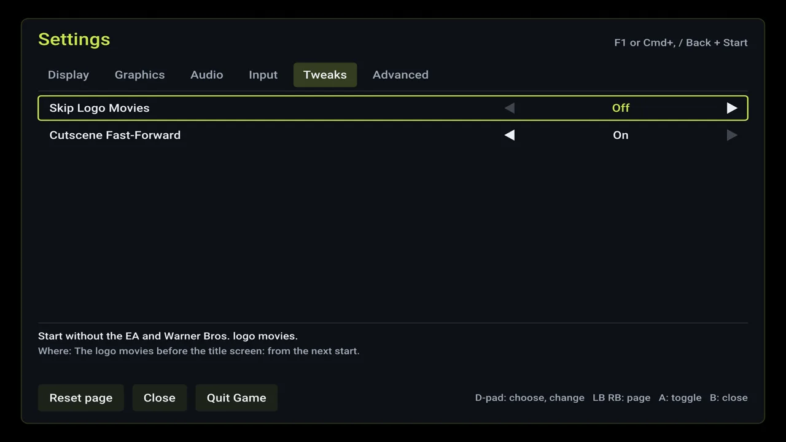 | |
| The settings menu: Tweaks | |

Taken on an M1 Pro, in a window; the game's 4:3 picture as Picture: Fit shows it.

## How it works

The Xbox runs the game's program, an x86 file called `default.xbe`, on an Intel CPU with Microsoft's kernel and an NVIDIA
graphics chip. A Mac has none of these, so:

- **The program is translated once.** A translator written in Python (xboxrecomp's) reads `default.xbe`, finds its functions
  and writes each as a C function. Apple's compiler turns that C into ARM code for your Mac. This happens on your
  Mac, from your disc, when you install: the download holds none of the game.
- **A runtime stands in for the Xbox.** What the game asked of the Xbox's kernel (threads, files, saves, timers) is done by
  xboxrecomp's runtime with macOS. The memory layout is the Xbox's own, so the game's pointers work unchanged.
- **Graphics:** the game still talks to the Xbox's graphics chip (it writes the chip's command lists). The runtime reads those
  commands and nfsu2-ios's Metal renderer draws them on your Mac's GPU, at a higher resolution. For this game the renderer learned
  fog, the chip's video overlay (for the movies) and a few details of the XDK this game was built with, which the NFS games never
  used.
- **Sound:** the Xbox's audio chip is emulated (code from the xemu emulator) and played through SDL. The movies are the game's own XMV files,
  decoded by the game and drawn by the renderer.
- **Hand-written parts:** some functions are replaced by hand (`engine/src/recomp_manual.c`): the graphics chip's
  interrupts and fences, the controller (after HP-COS and HP-PS-Xbox-Recomp), the movie overlay,
  the file-cache hold and the tweaks.

## Architecture

### From your disc to the app (once, when you install)

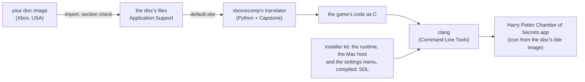

### While you play

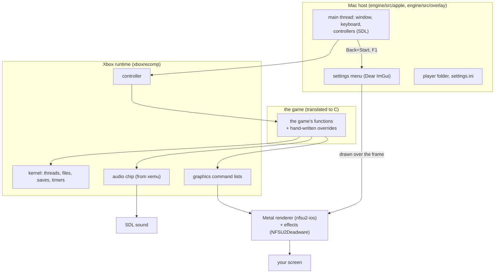

### The repository

| Folder | What |
|---|---|
| `engine/` | everything the game is built from: the runtime (`xboxrecomp/`), the game's overrides and the Mac host (`src/`), the settings menu (`src/overlay/`), Dear ImGui and the font (`third_party/`) |
| `installer/`, `mac/` | the installer app and the scripts it runs on the player's Mac (import and disc check, build, icon, app) |
| `tools/` | for developers: dependencies, release build, boot check, play, the installer kit and DMG, publish check |
| `tests/` | `dmg_no_game_code.sh`: the DMG holds no game code or data |
| `docs/` | how the port was made, how `engine/` was put together (`upstream-patches/`), screenshots |

Everything the port is built from is in this repository; nothing is downloaded at build time but SDL's pinned source and
Capstone (pip). The repository and the DMG hold no game files and no translated code.

### Build from source (macOS, Apple Silicon)

```sh
brew install cmake ninja
python3 -m venv .venv && .venv/bin/pip install 'capstone<6'
python3 mac/import_disc.py <your .iso> game/extracted   # your disc's files, checked
tools/build_deps.sh                   # SDL3 + sdl2-compat for macOS 15+ -> build/deps
tools/build_release.sh                # translate (engine/gen) + build -> build/release/hpcos (CMake target hpcos_recomp)
tools/smoke.sh                        # boot check: 75 s, START presses, the settings menu, the last frame not black
tools/play_dev.sh                     # play this build in a window, the log in the terminal (own HOME in build/play)
tools/make_dmg.sh                     # the installer DMG, checked by tests/dmg_no_game_code.sh
```

The runtime's environment variables keep their `NFSU2_` names (the engine is the NFS Underground 2 port's); the game's and the
installer's are `HPCOS_`.

**Diagnostics.** Environment variables: `NFSU2_GAME_DIR=<folder>` (the game's files; no player folder then),
`HPCOS_SKIP_LOGOS=1`, `HPCOS_SKIP_CUTSCENES=1`, `HPCOS_FPS=60`, `HPCOS_PAD_LOG=1` (every controller change),
`HPCOS_CACHE_HOLD=0` (file-cache hold off), `HPCOS_FC_TRACE`, `HPCOS_TRAP_LOG`, `RECOMP_IRQ_LOG`, `RECOMP_EVT_TRACE`,
`RECOMP_VS_DUMP=<dir>` (vertex programs), `RECOMP_DL_CONST=1|2`, `RECOMP_MTL_NODEPTH`, `RECOMP_MTL_NOATEST`, `RECOMP_SPLIT_WHO`,
`RECOMP_VPOFF_LOG`, `RECOMP_PAD_SCRIPT="<ms>:<buttons or stick>:<ms>,..."` (scripted input, sticks too: `lsu`, `rsr`, ...),
`NFSU2_SMOKE_SECONDS=<n>`, `NFSU2_OVERLAY_SCRIPT="<s>:open,<s>:next,<s>:shot,..."` with `NFSU2_OVERLAY_SHOT=<prefix>` (scripted
menu steps and screenshots). Dev scripts and the other switches: docs/PORTING.md. The installer: `HPCOS_IMPORT_ISO=<iso>`, `HPCOS_INSTALL_DIR=<folder>`, `HPCOS_NO_UI=1`,
`HPCOS_BUILD_JOBS=<n>`. Disc check: `python3 mac/xbe_check.py <default.xbe>`.

## Thanks

To everyone whose work this is built on:

| Project | Author | What it gives this port | License |
|---|---|---|---|
| [xboxrecomp](https://github.com/sp00nznet/xboxrecomp) | sp00nz | the Xbox translator and runtime | MIT |
| [HP-COS-Xbox-Recomp](https://github.com/MiddleDucky/HP-COS-Xbox-Recomp) | MiddleDucky | this game's facts (hidden functions, the XInput functions, the movie overlay, the file-cache race), the logo-skip code | MIT |
| [HP2-Recompiled](https://github.com/Barthes-Recompiled/HP2-Recompiled) | Barthes-Recompiled | the design of the cutscene fast-forward | MIT |
| [HP-PS-Xbox-Recomp](https://github.com/MiddleDucky/HP-PS-Xbox-Recomp) | MiddleDucky | the direct design of the controller | MIT |
| [nfsu2-sw](https://github.com/antoxa2584x/nfsu2-sw) | antoxa2584x (Anton Artemov) | the engine around xboxrecomp: lifter fixes, kernel and D3D glue | no license file; used here with credit, under this project's GPL-3.0-or-later |
| [nfsu2-ios](https://github.com/myUdav4iik/nfsu2-ios) | myUdav4iik | the Apple host and the Metal renderer | no license file; as above |
| [xemu](https://github.com/xemu-project/xemu) | xemu team | the audio chip and graphics parts in xboxrecomp | LGPL-2.1-or-later |
| [NFSU2Deadware](https://github.com/LeoDeadware/NFSU2Deadware) | LeoDeadware | the Mac engine patches (resolution, effects, pacing, mip chains), the installer's idea, kit, import and icon | MIT |
| [reUndr-ps5](https://github.com/bystritskiy/reUndr-ps5) | bystritskiy | the idea of the disc check by the executable's section digests | MIT |
| [SpeedBreaker](https://github.com/SpeedBreakerProject) | project(u) | the idea and the style of these Mac ports, the settings menu's design | GPL-3.0 |
| [Dear ImGui](https://github.com/ocornut/imgui) | Omar Cornut | draws the settings menu | MIT |
| [Roboto](https://fonts.google.com/specimen/Roboto) | Google | the settings menu's font | Apache-2.0 |
| [Capstone](https://github.com/capstone-engine/capstone) | Capstone team | reads the x86 code for the translator | BSD-3-Clause |
| [SDL](https://github.com/libsdl-org/SDL), [sdl2-compat](https://github.com/libsdl-org/sdl2-compat) | SDL team | window, input, controllers, sound | Zlib |

The license texts are in [LICENSES/](LICENSES/) and in the installer (`Contents/Resources/kit/licenses/`); details in
[THIRD_PARTY_NOTICES.md](THIRD_PARTY_NOTICES.md).

## License

GPL-3.0-or-later ([LICENSE](LICENSE), [NOTICE](NOTICE)). The files of nfsu2-sw and nfsu2-ios keep their authorship; how
`engine/` was made from them is in [docs/upstream-patches/](docs/upstream-patches/), and later changes are in this repository's
history. **If you reuse this code, keep the credit to those projects and their links**, as we do. HP-COS-Xbox-Recomp's, HP2-Recompiled's, HP-PS-Xbox-Recomp's and
NFSU2Deadware's code stays under the MIT License, xboxrecomp's xemu parts under the LGPL-2.1 (the installer links them on your
Mac, so they can be relinked with your own versions).

## Legal notice

Unofficial fan project, not affiliated with or endorsed by Warner Bros., Electronic Arts, Eurocom or Microsoft. Harry Potter characters,
names and related indicia are trademarks of and © Warner Bros. Entertainment Inc.; the game was developed by Eurocom and published by Electronic Arts Inc.;
Xbox is a trademark of Microsoft. This repository and its releases contain no game code and no game data: you need your own
legally obtained copy of the game, and the game is built from it on your own Mac.
